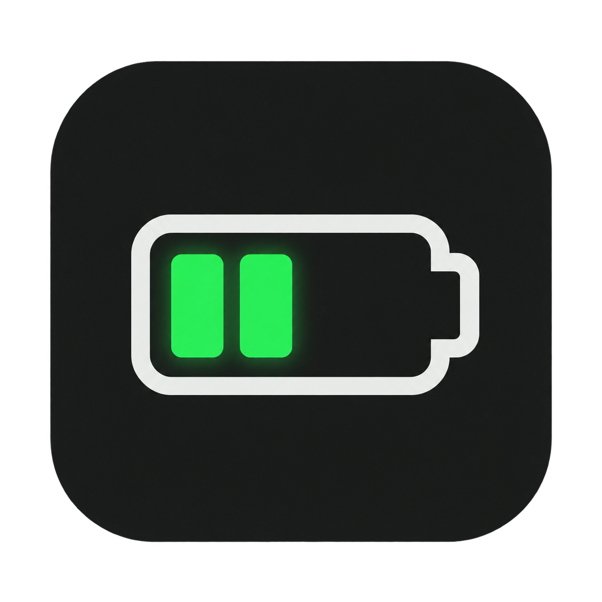
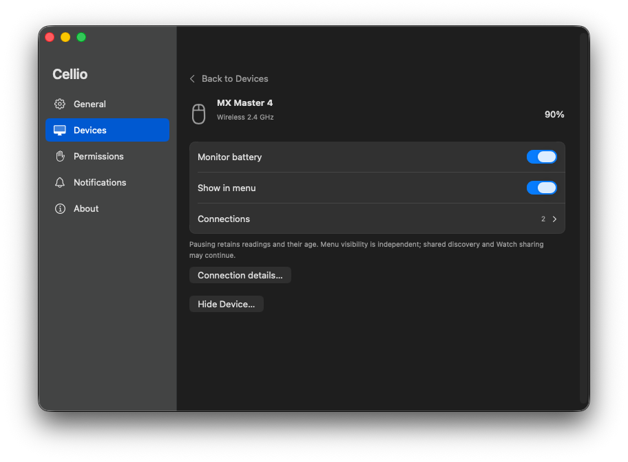
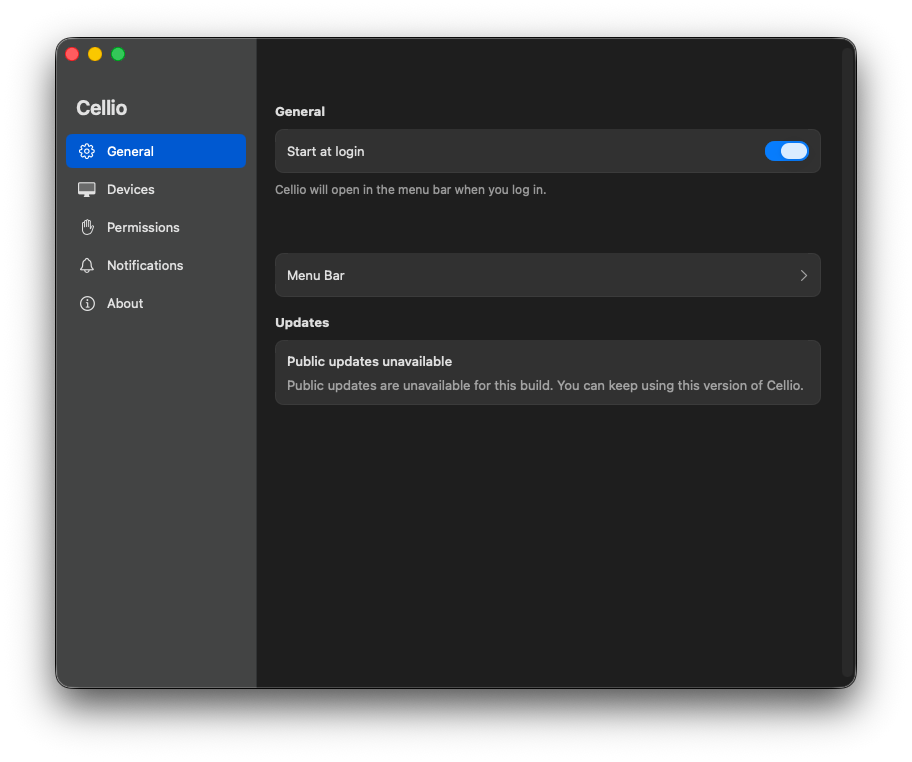
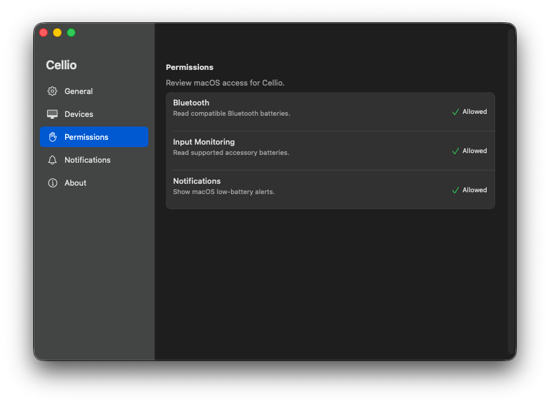

<p align="center"></p>
<h1 align="center">Cellio</h1>
<p align="center">Your accessories’ batteries, in your Mac’s menu bar.</p>

Cellio is an open-source native macOS app for checking accessory batteries without opening several vendor apps. This is an **early preview**: compatibility depends on the device, firmware and connection mode.

[Download the preview](https://github.com/UnkAtreus/Cellio/releases) · [Supported devices](docs/device-support.md) · [Request a device](https://github.com/UnkAtreus/Cellio/issues/new?template=device-support.yml)

## Features

- Battery readings for supported Apple, Logitech and Bluetooth accessories, including separate AirPods components when available.
- Configurable low-battery alerts, using macOS notifications or a smooth on-screen alert with three layouts and nine positions.
- Choose which devices and components to monitor or display; hide old devices and manage linked connections.
- Pin up to three readings in the menu bar, using percentages or battery gauges, with optional separators.
- System, Light or Dark appearance, plus a choice of app artwork.
- Start at login and a dedicated Permissions page.
- Sparkle update integration. **A public automatic-update feed is not configured in this preview**; download updates from Releases.

Missing readings stay unknown rather than becoming 0%. A status dot keeps the menu compact; hover for a short explanation or click an orange/red dot to copy diagnostics.

## Install

1. Download the universal macOS ZIP from [Releases](https://github.com/UnkAtreus/Cellio/releases).
2. Extract it, move **Cellio.app** into **Applications**, and open it. Cellio starts in the menu bar.
3. Open **Details & Settings… → Permissions** and allow the access needed by your devices. Notification permission is needed only for macOS alerts.

Requires **macOS 13 or later**, on Apple silicon or Intel. Native checks have been performed on macOS 26 and 27; the minimum deployment target is not a claim that every supported OS/device combination was physically tested.

The preview uses a persistent **self-signed certificate**, without Apple notarization. macOS may block the first launch. If you trust this release, follow [Apple’s instructions for opening an unidentified app](https://support.apple.com/en-us/102445). Keep system security enabled. See [signing and updates](docs/signing.md).

## Screenshots

Actual native build4 captures on macOS26, using Dark appearance. The battery value is the reading shown at capture time.



<details>
<summary>General and Permissions</summary>




</details>

## Device compatibility

Cellio reads data that the current connection exposes. Bluetooth, receiver and wired modes can expose different information. A charging-only cable or analog audio connection may provide no battery data to macOS.

The current hardware observations cover AirPods Pro, MX Master 4, PRO X 2 LIGHTSPEED, Fantech MAXFIT8 and SKYLOONG GK108S, with important mode-specific limits. Standard Bluetooth Battery Service and supported Logitech HID++ capabilities are detected at runtime. This does **not** mean every model from those brands is supported. Keychron and broader device coverage need owner reports. See the [compatibility matrix](docs/device-support.md).

Have a device we do not yet support? [Open a device request](https://github.com/UnkAtreus/Cellio/issues/new?template=device-support.yml). You only need its model, connection mode and what you observe; programming knowledge is not required. The [short guide](docs/request-device-support.md) explains what to share.

## Build and contribute

```sh
git clone https://github.com/UnkAtreus/Cellio.git
cd Cellio
swift test
CELLIO_ADHOC_DEVELOPMENT=1 ./scripts/build-macos.sh
open dist/Cellio.app
```

Use Xcode26.6 or Xcode27 with the macOS SDK and Python 3. The published test target covers portable core regressions; [validation notes](docs/validation.md) distinguish it from historical native campaigns. The pinned Sparkle framework and its licenses are included so building does not depend on an unpinned download. Ad-hoc signing above is for local development; use a persistent certificate for builds you install repeatedly. [Build instructions](docs/building.md).

Read [CONTRIBUTING.md](CONTRIBUTING.md) before changing device readers, identity merging, permissions or UI. Community device profiles and a constrained extension system are planned; there is no installable plugin SDK yet. Apple Watch companion setup is deferred.

**Every UX/UI change requires a dedicated UX/UI expert** to define the interaction contract and review actual native behavior. Preserve stable layouts, device/component identity, keyboard focus, and honest missing/stale data. The [UX checklist](docs/ux-ui.md) makes these checks concrete.

Development uses an evidence review → fresh isolated builder → independent tests → fresh final review process. A session that examines a reference app does not write Cellio application code. The selected model roles are:

| Role | Selected model |
| --- | --- |
| Builder | `gpt-6.1-sol`, high reasoning |
| Independent tests and three broken variants | `gpt-6-luna`, medium reasoning |
| Final review | `gpt-6-astra`, high reasoning |

These are workload choices, not a benchmark-equivalence claim about Opus or Haiku. See [contribution boundaries](CONTRIBUTING.md#implementation-boundaries).

## License

Cellio’s original code and first-party artwork are licensed under **GPL-2.0-only**. See [LICENSE](LICENSE). Third-party components retain their own licenses and notices; see [THIRD_PARTY_NOTICES.md](THIRD_PARTY_NOTICES.md).
